# Sistema de Parqueadero

Aplicación para registrar y controlar los vehículos que solicitan parqueo:
información de los vehículos, tiempos de parqueo, ubicaciones (espacios),
fechas de parqueo y formas de pago (PSE, Nequi, Daviplata y efectivo).

Proyecto académico de la materia **Bases de Datos**.

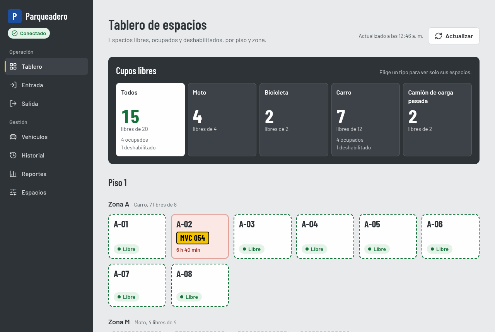

Las capturas de cada pantalla están en la sección [Pantallas](#pantallas).

## Tecnologías

| Capa          | Tecnología                                                             |
|---------------|------------------------------------------------------------------------|
| Base de datos | MySQL 8 (con Docker)                                                   |
| Backend       | Java 21 sin frameworks: `com.sun.net.httpserver.HttpServer` + JDBC puro |
| Frontend      | React + Vite + Tailwind CSS                                            |

## Pantallas

El frontend tiene ocho pantallas, todas en el menú lateral (en celular, en el botón "Menú").
Cada una muestra un mensaje claro mientras carga, si el backend no responde (con "Reintentar")
y cuando no hay datos.

### Tablero de espacios (`/`)


- **Letrero "Cupos libres":** muestra cuántos espacios libres hay por tipo de vehículo. Cada
  tipo es además un filtro.
- **Espacios por piso y zona**, pintados como en el piso del parqueadero:

  | Estado | Aspecto | Al tocarlo |
  |---|---|---|
  | Libre | Línea punteada verde | Lleva a registrar la entrada en ese espacio |
  | Ocupado | Rojo, con la placa y el tiempo | Lleva a cobrar la salida |
  | Deshabilitado | Rayas | Explica por qué no se puede usar |

- Se actualiza solo cada 30 segundos.

### Registrar entrada (`/entrada`)

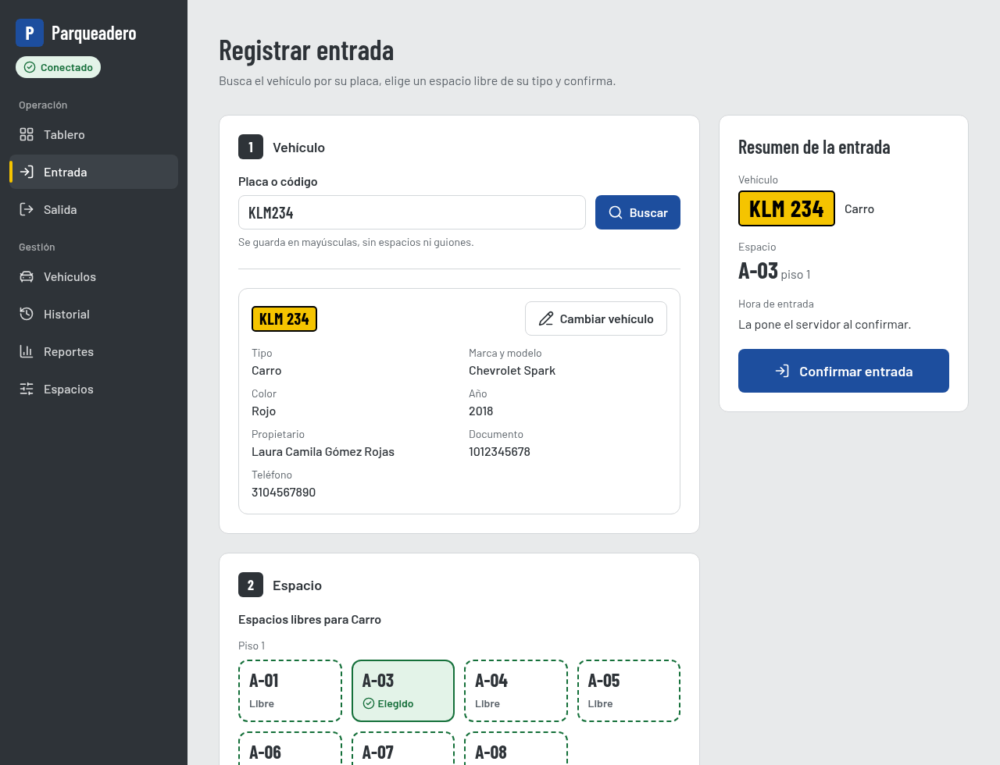

1. **Buscar el vehículo** por su placa.
2. **Si no existe,** registrarlo ahí mismo junto con su propietario. El tipo se asigna solo
   según la placa.
3. **Elegir un espacio libre de su tipo** tocando el cajón.
4. **Confirmar.**

El resumen de la derecha dice qué falta. Si el vehículo ya está dentro, avisa y ofrece cobrar su
salida.

### Vehículos dentro y cobro de la salida (`/salida`, `/salida/:id`)

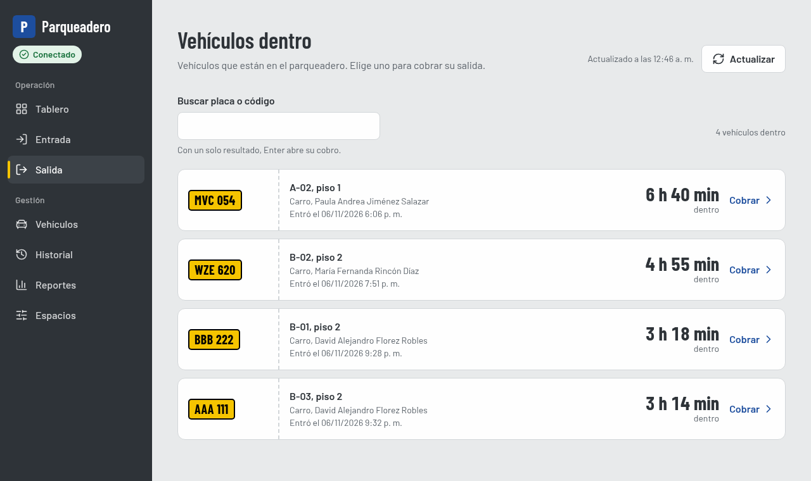

**Vehículos dentro:**
- muestra todos los vehículos que están dentro, con el tiempo que llevan;
- el buscador acepta parte de la placa;
- con un solo resultado, Enter abre su cobro.

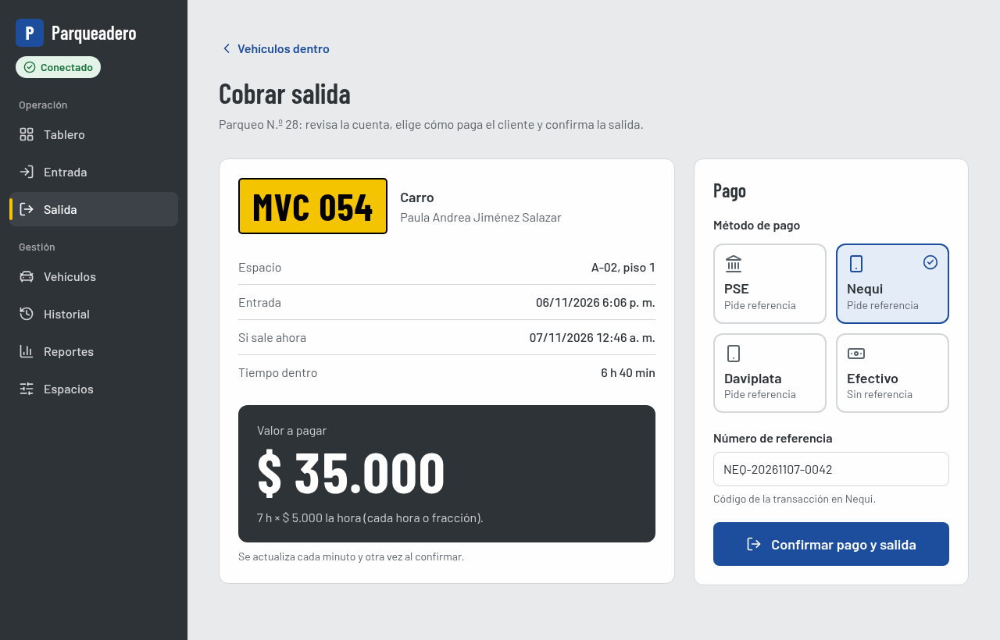

**Cobro:**
- **Cuenta:** el valor lo calcula el backend (hora o fracción, con la tarifa vigente el día de la
  entrada) y se vuelve a calcular justo antes de confirmar.
- **Pago:** se elige el método. PSE, Nequi y Daviplata piden el número de referencia.
- **Confirmación:** un modal confirma el pago y la salida, y termina en un recibo imprimible.

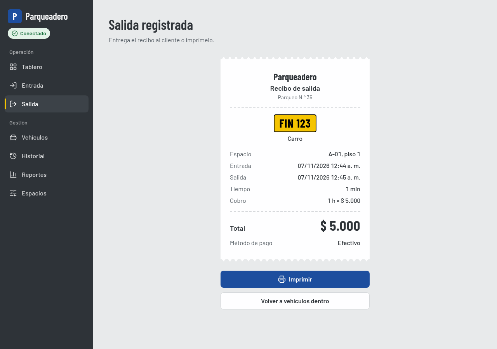

### Vehículos y propietarios (`/vehiculos`)

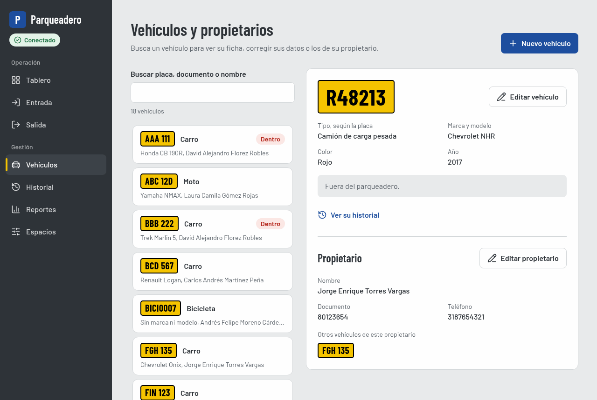

- **Lista con la ficha al lado.** Se maneja con el mouse o con las flechas del teclado, y el
  buscador acepta placa, documento o nombre.
- **Ficha:** datos del vehículo, si está dentro y su propietario, con sus otros vehículos y el
  enlace a su historial.
- **Edición:** el vehículo y el propietario se editan en modales separados. La placa y el tipo no
  se pueden cambiar.
- **"Nuevo vehículo":** usa el mismo formulario del registro rápido.

### Historial (`/historial`)

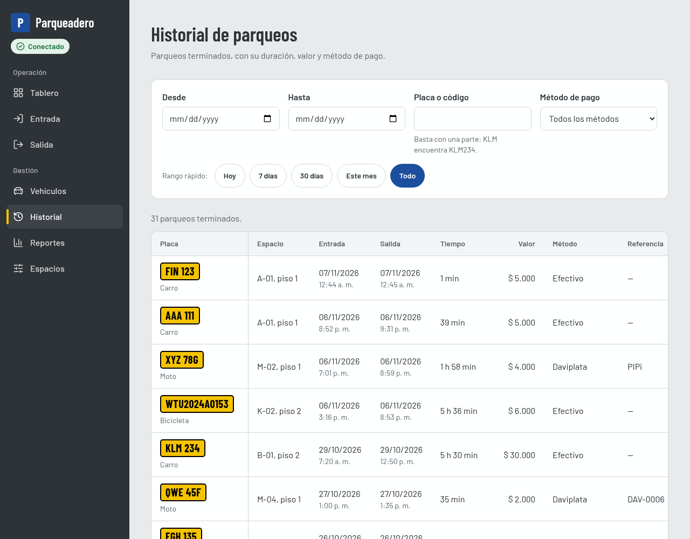

- **Qué muestra:** los parqueos terminados.
- **Filtros:** fechas (con atajos como "7 días" o "Este mes"), parte de la placa y método de
  pago. Quedan en la URL, así que se pueden compartir.
- **Tabla:** va de 20 en 20 filas y el total suma todos los resultados.
- **En celular:** la columna de la placa queda fija al desplazar la tabla de lado.

### Reportes (`/reportes`)

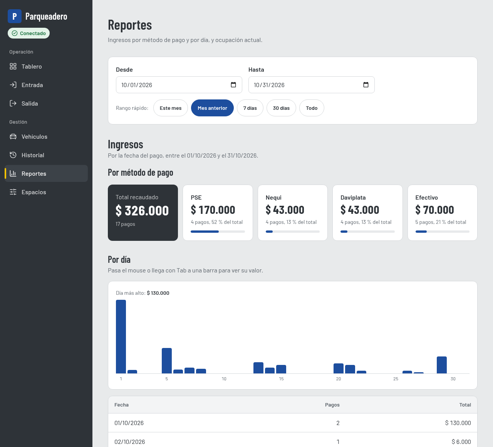

- **Ingresos por método de pago y por día**, en el rango elegido (por defecto, el mes actual).
- **Gráfico de barras** hecho solo con Tailwind. Al pasar el mouse o llegar con Tab se ve el
  valor de cada día.
- **Ocupación actual por tipo de vehículo.**

### Administración de espacios (`/espacios`)

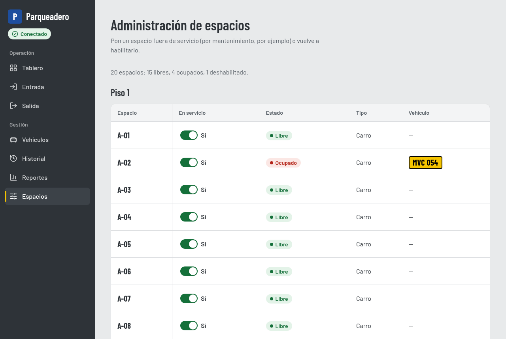

- Hay una tabla por piso, con un interruptor "En servicio" para poner un espacio fuera de servicio
  o volver a habilitarlo.
- Siempre pide confirmación. Si el espacio está ocupado, avisa que ese vehículo puede salir
  normalmente.

### En celular

| Tablero | Cobro |
|---|---|
| 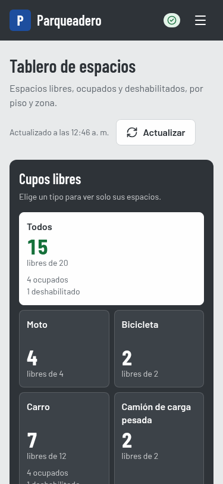 | 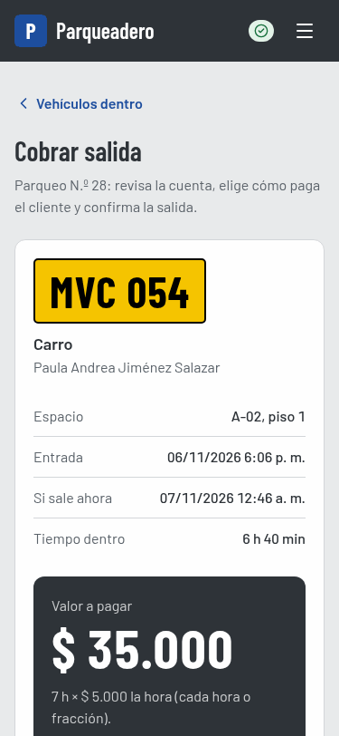 |

## Reglas del negocio que se ven en la app

- **El tipo del vehículo sale de su placa:**

  | Placa | Tipo |
  |---|---|
  | `ABC123` | Carro |
  | `ABC12D` | Moto |
  | `R12345` o `S12345` | Camión |
  | Cualquier otra | Bicicleta |

  En pantalla, "Camión" se muestra como **"Camión de carga pesada"**.
- **La placa y el tipo no se pueden editar** después de registrar el vehículo. El backend también
  lo impide.
- **El cobro es por hora o fracción,** con la tarifa vigente en la fecha de entrada. Con menos de
  un minuto no se cobra.
- **PSE, Nequi y Daviplata piden la referencia** de la transacción; el efectivo no.
- **Un vehículo solo puede tener un parqueo activo,** y solo puede entrar a un espacio libre, de
  su tipo y en servicio.

## Requisitos

- [Java 21](https://adoptium.net/) (JDK)
- [Maven](https://maven.apache.org/) 3.9 o superior
- [Node.js](https://nodejs.org/) 24.15 o superior (incluye npm)
- [Docker](https://www.docker.com/) con Docker Compose

Extensiones de VS Code recomendadas: al abrir el proyecto, VS Code las sugiere
automáticamente (ver `.vscode/extensions.json`).

## Estructura de carpetas

```
.
├── database/
│   └── migrations/     # Migraciones SQL versionadas (V{n}__descripcion.sql)
├── backend/            # Proyecto Maven (config, model, dao, service, handler, util)
├── frontend/           # Proyecto React + Vite + Tailwind CSS
│   └── src/
│       ├── api/        # Llamadas al backend (un archivo por recurso; único lugar con fetch)
│       ├── components/ # Piezas compartidas: layout, ui (botones, tablas, modal...), vehiculos, filtros
│       ├── context/    # Avisos flotantes (notificaciones)
│       ├── hooks/      # useConsulta (consultas a la API) y useIntervalo (actualizar solo)
│       ├── pages/      # Una carpeta por pantalla, con sus piezas y sus funciones puras
│       └── utils/      # Formato de pesos y fechas, placas, tipos de vehículo, rangos de fechas
├── documentacion/      # Guías (Docker, diseño del frontend, pruebas de la base) y capturas
├── .vscode/            # Extensiones recomendadas para el equipo
├── docker-compose.yml  # MySQL 8 (se crea en la Fase 1; usa el .env de la raíz)
├── .editorconfig       # Formato común: UTF-8, LF, indentación
├── .env.example        # Plantilla de variables de entorno
├── CLAUDE.md           # Reglas del proyecto
└── LICENSE             # Licencia GNU GPL v3
```

> Los cambios de esquema van **solo** en archivos nuevos dentro de
> `database/migrations/`. Nunca se modifica una migración ya existente.

## Flujo de ramas

```
main      ← versión estable / entregable
  └── develop   ← rama de integración
        ├── feature/<descripcion>   ← funcionalidades nuevas
        └── fix/<descripcion>       ← correcciones
```

1. Actualizar `develop`: `git checkout develop && git pull`
2. Crear la rama: `git checkout -b feature/registro-vehiculos`
3. Hacer commits pequeños con [Conventional Commits](https://www.conventionalcommits.org/es/):
   - `feat: agregar registro de vehículos`
   - `fix: corregir cálculo de tarifa`
   - `docs: actualizar README`
   - `refactor:`, `test:`, `chore:`
4. Subir la rama y abrir un Pull Request hacia `develop`.
5. Cuando `develop` esté estable, se integra en `main`.

## Cómo ejecutar

### 1. Variables de entorno

Primer paso común: copiar la plantilla de variables de entorno y ajustar los valores.

```bash
cp .env.example .env
```

### 2. Base de datos

Desde la raíz del repositorio (la primera vez crea las tablas y carga los datos
de prueba de `database/migrations/`):

```bash
docker compose up -d
```

Más detalles (encender y apagar Docker, volúmenes, errores comunes) en
[`documentacion/guia_docker.md`](documentacion/guia_docker.md).

### 3. Backend

Con MySQL encendido:

```bash
cd backend
mvn clean package                         # compila y ejecuta las pruebas JUnit
java -jar target/parqueadero-backend.jar  # inicia el servidor
```

Para comprobar que funciona, en otra terminal:

```bash
curl http://localhost:8080/api/salud
# {"estado":"OK","baseDatos":"OK"}
```

El servidor se detiene con `Ctrl+C`. Variables opcionales del `.env`:

| Variable      | Por defecto             | Para qué sirve                                         |
|---------------|-------------------------|--------------------------------------------------------|
| `PORT`        | `8080`                  | Puerto del servidor HTTP                               |
| `CORS_ORIGIN` | `http://localhost:5173` | Dirección del frontend que puede llamar a la API (CORS) |

Para probar la API sin escribir `curl`, abre [`backend/api.http`](backend/api.http)
con la extensión **REST Client** de VS Code y haz clic en *Send Request*: cada
petición indica el resultado esperado.

### 4. Frontend

Hecho con React + Vite + Tailwind CSS v4. La primera vez, desde `frontend/`, se
crea el archivo de variables de entorno y se instalan las dependencias:

```bash
cd frontend
cp .env.example .env.local   # VITE_API_URL=http://localhost:8080/api
npm install
```

`.env.local` no se sube al repositorio: cada integrante crea el suyo.

| Comando             | Para qué sirve                                                  |
|---------------------|-----------------------------------------------------------------|
| `npm run dev`       | Servidor de desarrollo en http://localhost:5173 (recarga en caliente) |
| `npm test -- --run` | Ejecuta las pruebas una vez (Vitest + Testing Library)          |
| `npm test`          | Ejecuta las pruebas en modo observador (se repiten al guardar)  |
| `npm run build`     | Compila la versión de producción en `frontend/dist/`            |
| `npm run preview`   | Sirve localmente la versión compilada                           |
| `npm run lint`      | Revisa la calidad del código con ESLint                         |
| `npm run format`    | Formatea el código con Prettier (y ordena las clases de Tailwind) |

Para que el frontend pueda llamar a la API, el backend debe estar encendido y
su `CORS_ORIGIN` (en el `.env` de la raíz) debe ser `http://localhost:5173`.

La URL del backend solo se define en `VITE_API_URL`; en el código no hay direcciones escritas.

### 5. Comprobar que todo está encendido

| Pieza | Cómo comprobarlo |
|---|---|
| Base de datos | `docker compose ps` muestra `parqueadero-mysql` en estado `Up` |
| Backend | http://localhost:8080/api/salud responde `{"estado":"OK","baseDatos":"OK"}` (si dice `"baseDatos":"ERROR"`, MySQL está apagado) |
| Frontend | En http://localhost:5173, el indicador bajo "Parqueadero" dice **Conectado** en verde; **Sin conexión** en rojo significa que el backend está apagado |

> Si ya tenías la base creada antes de noviembre de 2026, recréala una vez
> (`docker compose down -v && docker compose up -d`), porque los datos de prueba de
> `V003__datos_prueba.sql` se corrigieron. Ver
> [`documentacion/guia_docker.md`](documentacion/guia_docker.md).

## Pruebas

| Qué | Comando | Qué revisa |
|---|---|---|
| Backend | `cd backend && mvn clean package` | Pruebas JUnit de las reglas del negocio y las utilidades |
| Frontend | `cd frontend && npm test -- --run` | Pruebas de Vitest y Testing Library de cada pantalla, sus funciones y la accesibilidad (axe-core) |
| API a mano | [`backend/api.http`](backend/api.http) con REST Client | Cada petición dice el resultado esperado |
| Base de datos | [`documentacion/guia_pruebas_base_datos.md`](documentacion/guia_pruebas_base_datos.md) | Consultas, vistas y triggers |

Las reglas visuales y los componentes del frontend están en
[`documentacion/guia_diseno_frontend.md`](documentacion/guia_diseno_frontend.md).
