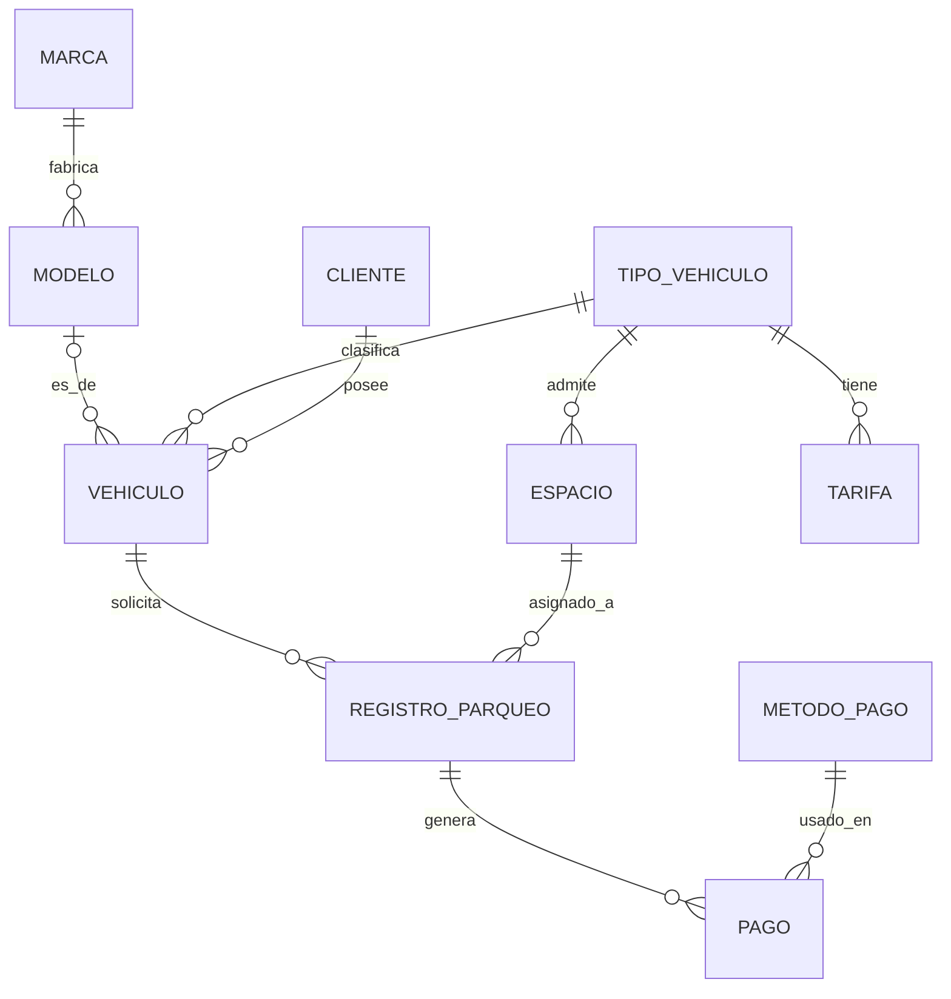

# Especificación de base de datos: sistema de parqueadero

## Contexto

Sistema para el registro y control de los vehículos que solicitan parqueo. Debe permitir registrar, actualizar y consultar la información de los vehículos, los tiempos de parqueo, las ubicaciones, las fechas de parqueo y las formas de pago (PSE, Nequi, Daviplata o efectivo). El parqueadero admite varios tipos de vehículo: motos, bicicletas, carros y camiones.

## Instrucciones para Claude Code

- Motor: **MySQL 8.0.16 o superior**, InnoDB, charset `utf8mb4`.
- Genera tres archivos en orden de ejecución:
  - `01_schema.sql`: `CREATE DATABASE parqueadero` y todas las tablas, en orden de dependencias.
  - `02_triggers.sql`: los triggers descritos en la sección "Reglas implementadas con triggers".
  - `03_seed.sql`: los datos iniciales de los catálogos.
- Nombra todas las restricciones de forma explícita con los prefijos `pk_`, `fk_`, `uq_`, `chk_` e `idx_`.
- Todas las llaves foráneas usan `ON DELETE RESTRICT ON UPDATE RESTRICT`, para no perder el historial de parqueos y pagos.
- Todas las llaves primarias son `INT UNSIGNED AUTO_INCREMENT`.
- No agregues tablas ni columnas que no estén en esta especificación. Si encuentras una inconsistencia, pregunta antes de cambiar el diseño.

## Diagrama entidad-relación



## Tablas

Orden de creación: `tipo_vehiculo`, `tarifa`, `marca`, `modelo`, `cliente`, `vehiculo`, `espacio`, `registro_parqueo`, `metodo_pago`, `pago`.

### tipo_vehiculo

Catálogo de tipos de vehículo.

| Columna | Tipo | Nulo | Restricciones |
|---|---|---|---|
| id_tipo | INT UNSIGNED | No | PK, AUTO_INCREMENT |
| nombre | VARCHAR(30) | No | UNIQUE (`uq_tipo_vehiculo_nombre`) |

### tarifa

Precios por tipo de vehículo. Un tipo tiene muchas tarifas a lo largo del tiempo (relación 1:N); cada tarifa pertenece a un solo tipo.

| Columna | Tipo | Nulo | Restricciones |
|---|---|---|---|
| id_tarifa | INT UNSIGNED | No | PK, AUTO_INCREMENT |
| id_tipo | INT UNSIGNED | No | FK → `tipo_vehiculo(id_tipo)` |
| valor_hora | DECIMAL(10,2) | No | CHECK `valor_hora > 0` |
| vigente_desde | DATE | No | |

Restricciones adicionales:
- `uq_tarifa_tipo_vigencia`: UNIQUE (`id_tipo`, `vigente_desde`). No puede haber dos tarifas del mismo tipo que empiecen el mismo día.

### marca

| Columna | Tipo | Nulo | Restricciones |
|---|---|---|---|
| id_marca | INT UNSIGNED | No | PK, AUTO_INCREMENT |
| nombre | VARCHAR(50) | No | UNIQUE (`uq_marca_nombre`) |

### modelo

Línea comercial del vehículo (por ejemplo, Spark, NMAX, NHR). No incluye el año.

| Columna | Tipo | Nulo | Restricciones |
|---|---|---|---|
| id_modelo | INT UNSIGNED | No | PK, AUTO_INCREMENT |
| id_marca | INT UNSIGNED | No | FK → `marca(id_marca)` |
| nombre | VARCHAR(60) | No | |

Restricciones adicionales:
- `uq_modelo_marca_nombre`: UNIQUE (`id_marca`, `nombre`).

### cliente

| Columna | Tipo | Nulo | Restricciones |
|---|---|---|---|
| id_cliente | INT UNSIGNED | No | PK, AUTO_INCREMENT |
| documento | VARCHAR(20) | No | UNIQUE (`uq_cliente_documento`) |
| nombres | VARCHAR(80) | No | |
| apellidos | VARCHAR(80) | No | |
| telefono | VARCHAR(15) | Sí | |

### vehiculo

`identificador` guarda la placa (motos, carros, camiones) o el número de marco o código interno (bicicletas). Es lo que el operario lee en el vehículo y se usa para buscarlo; `id_vehiculo` es solo interno.

| Columna | Tipo | Nulo | Restricciones |
|---|---|---|---|
| id_vehiculo | INT UNSIGNED | No | PK, AUTO_INCREMENT |
| identificador | VARCHAR(40) | No | UNIQUE (`uq_vehiculo_identificador`); CHECK `REGEXP_LIKE(identificador, '^[A-Z0-9]+$', 'c')` |
| id_tipo | INT UNSIGNED | No | FK → `tipo_vehiculo(id_tipo)` |
| id_modelo | INT UNSIGNED | Sí | FK → `modelo(id_modelo)`. Opcional: muchas bicicletas no tienen modelo identificable |
| id_cliente | INT UNSIGNED | No | FK → `cliente(id_cliente)` |
| color | VARCHAR(30) | Sí | |
| anio | SMALLINT UNSIGNED | Sí | CHECK `anio BETWEEN 1900 AND 2100` |

### espacio

Cada espacio está demarcado para un tipo de vehículo. `habilitado` indica si está en servicio; la ocupación NO se guarda aquí, se calcula desde `registro_parqueo` (registro con `salida` en NULL).

| Columna | Tipo | Nulo | Restricciones |
|---|---|---|---|
| id_espacio | INT UNSIGNED | No | PK, AUTO_INCREMENT |
| id_tipo | INT UNSIGNED | No | FK → `tipo_vehiculo(id_tipo)` |
| piso | VARCHAR(10) | No | |
| zona | VARCHAR(10) | No | |
| numero | VARCHAR(10) | No | |
| habilitado | BOOLEAN | No | DEFAULT TRUE |

Restricciones adicionales:
- `uq_espacio_ubicacion`: UNIQUE (`piso`, `zona`, `numero`).

### registro_parqueo

Entidad central. Se crea al entrar el vehículo y se completa al salir. `salida` en NULL significa que el vehículo sigue parqueado. `minutos_totales` y `valor_total` son atributos derivados que se guardan intencionalmente como foto del cobro, para que un cambio de tarifa futuro no altere cobros pasados. La tarifa NO se guarda aquí (ver "Decisiones de diseño").

| Columna | Tipo | Nulo | Restricciones |
|---|---|---|---|
| id_registro | INT UNSIGNED | No | PK, AUTO_INCREMENT |
| id_vehiculo | INT UNSIGNED | No | FK → `vehiculo(id_vehiculo)` |
| id_espacio | INT UNSIGNED | No | FK → `espacio(id_espacio)` |
| entrada | DATETIME | No | DEFAULT CURRENT_TIMESTAMP; índice `idx_registro_entrada` |
| salida | DATETIME | Sí | |
| minutos_totales | INT UNSIGNED | Sí | Derivado |
| valor_total | DECIMAL(10,2) | Sí | Derivado; CHECK `valor_total >= 0` |
| vehiculo_abierto | INT UNSIGNED | Sí | Columna generada STORED: `IF(salida IS NULL, id_vehiculo, NULL)`; UNIQUE (`uq_registro_vehiculo_abierto`) |
| espacio_abierto | INT UNSIGNED | Sí | Columna generada STORED: `IF(salida IS NULL, id_espacio, NULL)`; UNIQUE (`uq_registro_espacio_abierto`) |

Restricciones adicionales:
- `chk_registro_salida_posterior`: `salida IS NULL OR salida > entrada`.
- `chk_registro_cierre_completo`: `(salida IS NULL AND minutos_totales IS NULL AND valor_total IS NULL) OR (salida IS NOT NULL AND minutos_totales IS NOT NULL AND valor_total IS NOT NULL)`.
- Las columnas generadas `vehiculo_abierto` y `espacio_abierto` garantizan que un vehículo no tenga dos registros abiertos a la vez y que un espacio no tenga dos vehículos al mismo tiempo. Funciona porque MySQL permite varios NULL en una columna UNIQUE, así que solo se compara entre registros abiertos.

### metodo_pago

Catálogo de formas de pago.

| Columna | Tipo | Nulo | Restricciones |
|---|---|---|---|
| id_metodo | INT UNSIGNED | No | PK, AUTO_INCREMENT |
| nombre | VARCHAR(20) | No | UNIQUE (`uq_metodo_pago_nombre`) |
| requiere_referencia | BOOLEAN | No | Sin DEFAULT. Indica si el método exige `pago.referencia` |

### pago

Un registro puede tener uno o varios pagos (relación 1:N), lo que permite pagos divididos entre métodos.

| Columna | Tipo | Nulo | Restricciones |
|---|---|---|---|
| id_pago | INT UNSIGNED | No | PK, AUTO_INCREMENT |
| id_registro | INT UNSIGNED | No | FK → `registro_parqueo(id_registro)` |
| id_metodo | INT UNSIGNED | No | FK → `metodo_pago(id_metodo)` |
| monto | DECIMAL(10,2) | No | CHECK `monto > 0` |
| fecha_pago | DATETIME | No | DEFAULT CURRENT_TIMESTAMP |
| referencia | VARCHAR(60) | Sí | UNIQUE (`uq_pago_referencia`). Código de transacción de PSE, Nequi o Daviplata; NULL en efectivo |

## Reglas implementadas con triggers

1. **Normalizar el identificador del vehículo** (`BEFORE INSERT` y `BEFORE UPDATE` en `vehiculo`): convertir a mayúsculas y quitar espacios y guiones, para que "abc-123" y "ABC123" no queden como vehículos distintos. Ejemplo: `SET NEW.identificador = UPPER(REPLACE(REPLACE(NEW.identificador, ' ', ''), '-', ''));`
2. **El tipo del vehículo debe coincidir con el tipo del espacio** (`BEFORE INSERT` y `BEFORE UPDATE` en `registro_parqueo`): si `vehiculo.id_tipo` es distinto de `espacio.id_tipo`, lanzar `SIGNAL SQLSTATE '45000'` con un mensaje claro.
3. **Solo se puede parquear en espacios habilitados** (`BEFORE INSERT` en `registro_parqueo`): si `espacio.habilitado` es FALSE, lanzar `SIGNAL SQLSTATE '45000'`.

Si los triggers 2 y 3 aplican al mismo evento, combínalos en un solo trigger por evento.

## Reglas que maneja la aplicación (no van en la base de datos)

- **Tarifa aplicable:** la del tipo del vehículo con el `vigente_desde` más reciente que no sea posterior a la fecha de entrada. Consulta de referencia:
  ```sql
  SELECT t.valor_hora
  FROM registro_parqueo r
  JOIN vehiculo v ON v.id_vehiculo = r.id_vehiculo
  JOIN tarifa t ON t.id_tipo = v.id_tipo
  WHERE r.id_registro = ?
    AND t.vigente_desde <= DATE(r.entrada)
  ORDER BY t.vigente_desde DESC
  LIMIT 1;
  ```
- **Cierre del registro:** al registrar la salida, calcular `minutos_totales` y `valor_total` con la tarifa aplicable. La regla de redondeo (hora completa o fracción) la define el negocio.
- La suma de los pagos de un registro debe ser igual a su `valor_total`.
- Los pagos con un método cuyo `requiere_referencia` es TRUE (PSE, Nequi, Daviplata) deben llevar `referencia`.

## Datos iniciales (03_seed.sql)

- `tipo_vehiculo`: Moto, Bicicleta, Carro, Camión.
- `metodo_pago`: PSE, Nequi y Daviplata con `requiere_referencia` TRUE; Efectivo con FALSE.

## Decisiones de diseño (contexto, no modificar)

- `vehiculo` usa una llave sustituta (`id_vehiculo`) porque las bicicletas no tienen placa; la unicidad del vehículo la garantiza `identificador`.
- `marca` y `modelo` están separadas para eliminar la dependencia transitiva modelo → marca (tercera forma normal). El año queda en `vehiculo` porque es propio de cada unidad, no de la línea.
- `tarifa` se relaciona solo con `tipo_vehiculo`. No se guarda `id_tarifa` en `registro_parqueo` porque es deducible (registro → vehículo → tipo → tarifa vigente), y guardarla creaba un ciclo que permitía inconsistencias (por ejemplo, una moto con tarifa de camión).
- `espacio` sí se relaciona con `tipo_vehiculo` y con `registro_parqueo`: ninguna de las dos relaciones es deducible de la otra. La posible contradicción entre ambos caminos se controla con el trigger 2.
