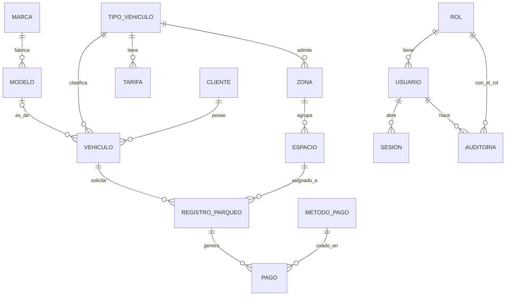

# Especificación de base de datos: sistema de parqueadero

## Contexto

Sistema para el registro y control de los vehículos que solicitan parqueo. Debe permitir registrar, actualizar y consultar la información de los vehículos, los tiempos de parqueo, las ubicaciones, las fechas de parqueo y las formas de pago (PSE, Nequi, Daviplata o efectivo). El parqueadero admite varios tipos de vehículo: motos, bicicletas, carros y camiones.

## Instrucciones para Claude Code

- Motor: **MySQL 8.0.16 o superior**, InnoDB, charset `utf8mb4`.
- Los scripts son migraciones en `database/migrations/`, que Docker ejecuta en orden al crear la base:
  - `V001__crear_tablas.sql`: todas las tablas, en orden de dependencias. No crea la base de datos: la crea Docker con `DB_NAME` del `.env`.
  - `V002__datos_catalogo.sql`: tipos de vehículo, métodos de pago, tarifas y espacios.
  - `V003__datos_prueba.sql`: clientes, vehículos, parqueos y pagos de prueba.
  - `V004__vistas.sql`: las vistas de consulta.
  - `V005__triggers.sql`: los triggers descritos en la sección "Reglas implementadas con triggers".
  - `V006__normalizar_zonas.sql`: crea la tabla `zona`, pasa a ella el piso y el tipo de vehículo de cada espacio y vuelve a crear las vistas y los triggers que los usaban (ver "Decisiones de diseño").
  - `V007__usuarios_y_sesiones.sql`: roles, usuarios y sesiones de la aplicación.
  - `V008__auditoria.sql`: tabla `auditoria`, la función `fn_rol_auditable`, 8 triggers de auditoría y dos vistas.
  - `V009__rol_aplicacion.sql`: el rol de MySQL de mínimo privilegio para el usuario del backend (ver "Seguridad").
- Una base que ya existe no vuelve a ejecutar las migraciones: una nueva se aplica con `./database/scripts/aplicar-migracion.sh database/migrations/V00N__....sql`, que antes hace un respaldo.
- Nombra todas las restricciones de forma explícita con los prefijos `pk_`, `fk_`, `uq_`, `chk_` e `idx_`.
- Todas las llaves foráneas usan `ON DELETE RESTRICT ON UPDATE RESTRICT`, para no perder el historial de parqueos y pagos.
- Todas las llaves primarias son `INT UNSIGNED AUTO_INCREMENT`.
- No agregues tablas ni columnas que no estén en esta especificación. Si encuentras una inconsistencia, pregunta antes de cambiar el diseño.

## Diagrama entidad-relación



`AUDITORIA` también guarda el id de la fila cambiada (`id_fila`), sin llave foránea porque apunta a tablas distintas según la columna `tabla`.

## Tablas

Orden de creación: `tipo_vehiculo`, `tarifa`, `marca`, `modelo`, `cliente`, `vehiculo`, `espacio`, `registro_parqueo`, `metodo_pago`, `pago` (V001), `zona` (V006), `rol`, `usuario`, `sesion` (V007) y `auditoria` (V008).

### tipo_vehiculo

Catálogo de tipos de vehículo.

| Columna | Tipo | Nulo | Restricciones |
|---|---|---|---|
| id_tipo | INT UNSIGNED | No | PK, AUTO_INCREMENT |
| nombre | VARCHAR(30) | No | UNIQUE (`uq_tipo_vehiculo_nombre`) |

### tarifa

Precios por tipo de vehículo. Un tipo tiene muchas tarifas a lo largo del tiempo (relación 1:N); cada tarifa pertenece a un solo tipo.

| Columna | Tipo | Nulo | Restricciones |
|---|---|---|---|
| id_tarifa | INT UNSIGNED | No | PK, AUTO_INCREMENT |
| id_tipo | INT UNSIGNED | No | FK → `tipo_vehiculo(id_tipo)` |
| valor_hora | DECIMAL(10,2) | No | CHECK `valor_hora > 0` |
| vigente_desde | DATE | No | |

Restricciones adicionales:
- `uq_tarifa_tipo_vigencia`: UNIQUE (`id_tipo`, `vigente_desde`). No puede haber dos tarifas del mismo tipo que empiecen el mismo día.

### marca

| Columna | Tipo | Nulo | Restricciones |
|---|---|---|---|
| id_marca | INT UNSIGNED | No | PK, AUTO_INCREMENT |
| nombre | VARCHAR(50) | No | UNIQUE (`uq_marca_nombre`) |

### modelo

Línea comercial del vehículo (por ejemplo, Spark, NMAX, NHR). No incluye el año.

| Columna | Tipo | Nulo | Restricciones |
|---|---|---|---|
| id_modelo | INT UNSIGNED | No | PK, AUTO_INCREMENT |
| id_marca | INT UNSIGNED | No | FK → `marca(id_marca)` |
| nombre | VARCHAR(60) | No | |

Restricciones adicionales:
- `uq_modelo_marca_nombre`: UNIQUE (`id_marca`, `nombre`).

### cliente

| Columna | Tipo | Nulo | Restricciones |
|---|---|---|---|
| id_cliente | INT UNSIGNED | No | PK, AUTO_INCREMENT |
| documento | VARCHAR(20) | No | UNIQUE (`uq_cliente_documento`) |
| nombres | VARCHAR(80) | No | |
| apellidos | VARCHAR(80) | No | |
| telefono | VARCHAR(15) | Sí | |

### vehiculo

`identificador` guarda la placa (motos, carros, camiones) o el número de marco o código interno (bicicletas). Es lo que el operario lee en el vehículo y se usa para buscarlo; `id_vehiculo` es solo interno.

| Columna | Tipo | Nulo | Restricciones |
|---|---|---|---|
| id_vehiculo | INT UNSIGNED | No | PK, AUTO_INCREMENT |
| identificador | VARCHAR(40) | No | UNIQUE (`uq_vehiculo_identificador`); CHECK `REGEXP_LIKE(identificador, '^[A-Z0-9]+$', 'c')` |
| id_tipo | INT UNSIGNED | No | FK → `tipo_vehiculo(id_tipo)` |
| id_modelo | INT UNSIGNED | Sí | FK → `modelo(id_modelo)`. Opcional: muchas bicicletas no tienen modelo identificable |
| id_cliente | INT UNSIGNED | No | FK → `cliente(id_cliente)` |
| color | VARCHAR(30) | Sí | |
| anio | SMALLINT UNSIGNED | Sí | CHECK `anio BETWEEN 1900 AND 2100` |

### zona (V006)

Un área de un piso demarcada para un solo tipo de vehículo. La misma letra puede repetirse en pisos distintos; por eso la zona se nombra con la letra seguida del piso: **A1** es la zona A del piso 1 y **A2** la del piso 2. No hay tabla de pisos: un piso existe cuando tiene al menos una zona.

| Columna | Tipo | Nulo | Restricciones |
|---|---|---|---|
| id_zona | INT UNSIGNED | No | PK, AUTO_INCREMENT |
| piso | VARCHAR(2) | No | CHECK: número del 1 al 99, sin ceros a la izquierda |
| letra | CHAR(1) | No | CHECK: una letra mayúscula de la A a la Z |
| id_tipo | INT UNSIGNED | No | FK → `tipo_vehiculo(id_tipo)` |

Restricciones adicionales:
- `uq_zona_piso_letra`: UNIQUE (`piso`, `letra`). En un piso no se repite la letra.

### espacio

Cada espacio pertenece a una zona, y de ella toma el piso y el tipo de vehículo. `habilitado` indica si está en servicio; la ocupación NO se guarda aquí, se calcula desde `registro_parqueo` (registro con `estado` = 'ACTIVO'). En pantalla se nombra zona-número: **A1-01**.

| Columna | Tipo | Nulo | Restricciones |
|---|---|---|---|
| id_espacio | INT UNSIGNED | No | PK, AUTO_INCREMENT |
| id_zona | INT UNSIGNED | No | FK → `zona(id_zona)` |
| numero | VARCHAR(2) | No | CHECK: dos dígitos, del 01 al 99 |
| habilitado | BOOLEAN | No | DEFAULT TRUE |

Restricciones adicionales:
- `uq_espacio_zona_numero`: UNIQUE (`id_zona`, `numero`). En una zona no se repite el número.

Hasta V005, `espacio` tenía además `id_tipo`, `piso` y `zona` (texto), con UNIQUE (`piso`, `zona`, `numero`). V006 los pasó a `zona` sin cambiar los `id_espacio`.

### registro_parqueo

Entidad central. Se crea al entrar el vehículo (`estado` = 'ACTIVO') y se completa al salir y cobrar (`estado` = 'PAGO'). `minutos_totales` y `valor_total` son atributos derivados que se guardan intencionalmente como foto del cobro, para que un cambio de tarifa futuro no altere cobros pasados. La tarifa NO se guarda aquí (ver "Decisiones de diseño").

| Columna | Tipo | Nulo | Restricciones |
|---|---|---|---|
| id_registro | INT UNSIGNED | No | PK, AUTO_INCREMENT |
| id_vehiculo | INT UNSIGNED | No | FK → `vehiculo(id_vehiculo)` |
| id_espacio | INT UNSIGNED | No | FK → `espacio(id_espacio)` |
| entrada | DATETIME | No | DEFAULT CURRENT_TIMESTAMP; índice `idx_registro_entrada` |
| salida | DATETIME | Sí | |
| minutos_totales | INT UNSIGNED | Sí | Derivado |
| valor_total | DECIMAL(10,2) | Sí | Derivado; CHECK `valor_total >= 0` |
| estado | VARCHAR(6), collation `utf8mb4_bin` | No | DEFAULT 'ACTIVO'. Valores: 'ACTIVO' (sigue adentro) o 'PAGO' (salió y se cobró) |

Restricciones adicionales:
- `chk_registro_estado_valido`: `estado IN ('ACTIVO', 'PAGO')` (distingue mayúsculas por la collation binaria).
- `chk_registro_estado_coherente`: `(estado = 'ACTIVO' AND salida IS NULL AND minutos_totales IS NULL AND valor_total IS NULL) OR (estado = 'PAGO' AND salida IS NOT NULL AND minutos_totales IS NOT NULL AND valor_total IS NOT NULL)`.
- `chk_registro_salida_posterior`: `salida IS NULL OR salida > entrada`.
- `chk_registro_minutos_coherentes`: `minutos_totales IS NULL OR minutos_totales = TIMESTAMPDIFF(MINUTE, entrada, salida)`.
- `uq_registro_vehiculo_activo`: índice UNIQUE funcional sobre `IF(estado = 'ACTIVO', id_vehiculo, NULL)`. Un vehículo no puede tener dos registros ACTIVO.
- `uq_registro_espacio_activo`: índice UNIQUE funcional sobre `IF(estado = 'ACTIVO', id_espacio, NULL)`. Un espacio no puede tener dos vehículos a la vez.
- Los dos índices funcionan porque un UNIQUE admite varios NULL: los registros PAGO valen NULL y nunca chocan, así que solo se comparan los ACTIVO. MySQL guarda la expresión en una columna virtual oculta que no aparece en `SELECT *` ni se llena en el INSERT.

### metodo_pago

Catálogo de formas de pago.

| Columna | Tipo | Nulo | Restricciones |
|---|---|---|---|
| id_metodo | INT UNSIGNED | No | PK, AUTO_INCREMENT |
| nombre | VARCHAR(20) | No | UNIQUE (`uq_metodo_pago_nombre`) |
| requiere_referencia | BOOLEAN | No | Sin DEFAULT. Indica si el método exige `pago.referencia` |

### pago

Un registro puede tener uno o varios pagos (relación 1:N), lo que permite pagos divididos entre métodos.

| Columna | Tipo | Nulo | Restricciones |
|---|---|---|---|
| id_pago | INT UNSIGNED | No | PK, AUTO_INCREMENT |
| id_registro | INT UNSIGNED | No | FK → `registro_parqueo(id_registro)` |
| id_metodo | INT UNSIGNED | No | FK → `metodo_pago(id_metodo)` |
| monto | DECIMAL(10,2) | No | CHECK `monto > 0` |
| fecha_pago | DATETIME | No | DEFAULT CURRENT_TIMESTAMP |
| referencia | VARCHAR(60) | Sí | UNIQUE (`uq_pago_referencia`). Código de transacción de PSE, Nequi o Daviplata; NULL en efectivo |

### rol (V007)

Catálogo de roles de la aplicación: `DBA`, `ADMINISTRADOR` y `OPERADOR`. Son jerárquicos: cada uno puede todo lo del anterior. El backend tiene la misma lista (`model/Rol.java`).

| Columna | Tipo | Nulo | Restricciones |
|---|---|---|---|
| id_rol | INT UNSIGNED | No | PK, AUTO_INCREMENT |
| nombre | VARCHAR(20) | No | UNIQUE |

### usuario (V007)

Personas que inician sesión en la aplicación. **No son usuarios de MySQL**: el backend siempre se conecta con una sola cuenta (`DB_USER`). Los usuarios no se borran, se desactivan (la auditoría los referencia). El primer DBA lo crea el backend al arrancar con `DBA_USUARIO` y `DBA_CLAVE_INICIAL` del `.env`.

| Columna | Tipo | Nulo | Restricciones |
|---|---|---|---|
| id_usuario | INT UNSIGNED | No | PK, AUTO_INCREMENT |
| nombre_usuario | VARCHAR(30) | No | UNIQUE; CHECK: de 3 a 30 minúsculas, números, punto o guion bajo |
| nombre_completo | VARCHAR(100) | No | CHECK: no vacío |
| clave_hash | VARCHAR(255) | No | `pbkdf2_sha256$<iteraciones>$<sal>$<hash>`; nunca la contraseña |
| id_rol | INT UNSIGNED | No | FK → `rol(id_rol)` |
| activo | BOOLEAN | No | DEFAULT TRUE |
| creado_en | DATETIME | No | DEFAULT CURRENT_TIMESTAMP |

### sesion (V007)

Sesiones abiertas. Se guarda el **hash SHA-256 del token**, no el token: quien lea la tabla no puede usar esos datos para entrar. Una sesión dura 8 horas; cerrar sesión, desactivar al usuario o cambiarle el rol o la contraseña borra sus sesiones.

| Columna | Tipo | Nulo | Restricciones |
|---|---|---|---|
| token_hash | CHAR(64) | No | PK; CHECK: 64 dígitos hexadecimales en minúscula |
| id_usuario | INT UNSIGNED | No | FK → `usuario(id_usuario)` |
| creada | DATETIME | No | DEFAULT CURRENT_TIMESTAMP |
| expira | DATETIME | No | CHECK: `expira > creada` |

### auditoria (V008)

Un registro por cada cambio que hacen operadores y administradores desde la aplicación. La llenan los triggers; la aplicación solo la lee.

| Columna | Tipo | Nulo | Restricciones |
|---|---|---|---|
| id_auditoria | BIGINT UNSIGNED | No | PK, AUTO_INCREMENT |
| fecha | DATETIME | No | DEFAULT CURRENT_TIMESTAMP |
| tabla | VARCHAR(30) | No | CHECK: cliente, vehiculo, espacio, registro_parqueo o pago |
| operacion | VARCHAR(6) | No | CHECK: INSERT o UPDATE |
| id_fila | INT UNSIGNED | No | Llave de la fila cambiada (sin FK: apunta a tablas distintas) |
| id_usuario | INT UNSIGNED | No | FK → `usuario(id_usuario)` |
| id_rol | INT UNSIGNED | No | FK → `rol(id_rol)`; el rol **en ese momento** |
| datos_antes | JSON | Sí | La fila antes del cambio; NULL en un INSERT |
| datos_despues | JSON | No | La fila después del cambio |

Restricciones adicionales: `chk_auditoria_datos_coherentes` (INSERT sin `datos_antes`, UPDATE con `datos_antes`).

## Reglas implementadas con triggers

1. **Normalizar el identificador del vehículo** (`BEFORE INSERT` y `BEFORE UPDATE` en `vehiculo`): convertir a mayúsculas y quitar espacios y guiones, para que "abc-123" y "ABC123" no queden como vehículos distintos. Ejemplo: `SET NEW.identificador = UPPER(REPLACE(REPLACE(NEW.identificador, ' ', ''), '-', ''));`
2. **El tipo del vehículo debe coincidir con el tipo del espacio** (`BEFORE INSERT` y `BEFORE UPDATE` en `registro_parqueo`): si `vehiculo.id_tipo` es distinto del tipo de la zona del espacio (`zona.id_tipo`; hasta V005, `espacio.id_tipo`), lanzar `SIGNAL SQLSTATE '45000'` con un mensaje claro.
3. **Solo se puede parquear en espacios habilitados** (`BEFORE INSERT` en `registro_parqueo`): si `espacio.habilitado` es FALSE, lanzar `SIGNAL SQLSTATE '45000'`.

Si los triggers 2 y 3 aplican al mismo evento, combínalos en un solo trigger por evento.

Implementados en `database/migrations/V005__triggers.sql`; V006 vuelve a crear los dos de `registro_parqueo` para que lean el tipo desde `zona`, con las mismas reglas y mensajes. En `BEFORE UPDATE` de `registro_parqueo` se valida solo si cambia el vehículo o el espacio; si se mueve a otro espacio, también debe estar habilitado. Así, cerrar un registro nunca se bloquea.

### Auditoría (V008)

8 triggers `AFTER`: `INSERT` y `UPDATE` de `cliente`, `vehiculo` y `registro_parqueo` (la entrada es el INSERT y la salida el UPDATE), `INSERT` de `pago` y `UPDATE` de `espacio` (habilitar o deshabilitar). Cada uno:
1. llama a `fn_rol_auditable(@id_usuario_app)`, una función almacenada que devuelve el rol del usuario si sus cambios se auditan, o NULL si no (no hay usuario, no existe o es DBA);
2. si hay rol, inserta en `auditoria` la fila antes y después como JSON (`JSON_OBJECT`), con datos legibles como la placa o el código del espacio (`A1-01`).

`@id_usuario_app` es una **variable de sesión** de MySQL: el backend la fija en cada conexión con el id del usuario de la petición (`ConexionBD` y `UsuarioActual`). Un cambio hecho fuera de la aplicación no la tiene y no se audita. Como los triggers corren en la misma transacción, si la operación se deshace, su fila de auditoría también.

## Reglas que maneja la aplicación (no van en la base de datos)

- **Tarifa aplicable:** la del tipo del vehículo con el `vigente_desde` más reciente que no sea posterior a la fecha de entrada. Consulta de referencia:
  ```sql
  SELECT t.valor_hora
  FROM registro_parqueo r
  JOIN vehiculo v ON v.id_vehiculo = r.id_vehiculo
  JOIN tarifa t ON t.id_tipo = v.id_tipo
  WHERE r.id_registro = ?
    AND t.vigente_desde <= DATE(r.entrada)
  ORDER BY t.vigente_desde DESC
  LIMIT 1;
  ```
- **Cierre del registro:** al registrar la salida, calcular `minutos_totales` y `valor_total` con la tarifa aplicable, poner `estado` = 'PAGO' e insertar los pagos, todo en una misma transacción. La regla de redondeo (hora completa o fracción) la define el negocio.
- La suma de los pagos de un registro debe ser igual a su `valor_total`.
- Los pagos con un método cuyo `requiere_referencia` es TRUE (PSE, Nequi, Daviplata) deben llevar `referencia`.

## Vistas (V004__vistas.sql)

V006 vuelve a crear las tres que usan espacios para que tomen el piso, la letra y el tipo de la tabla `zona`, con los mismos nombres de columna (`piso`, `zona`, `numero`, `id_tipo`). Así el código que las consulta no cambió.

- `vw_espacios_disponibles`: espacios habilitados sin registro en estado 'ACTIVO'.
- `vw_parqueos_activos`: registros 'ACTIVO' con placa, tipo, cliente, espacio y `minutos_transcurridos` (calculado con `NOW()` al consultar).
- `vw_historial_parqueos`: registros 'PAGO', una fila por parqueo. Si hubo varios pagos, los métodos y las referencias se unen con ' + '.
- `vw_ingresos_por_metodo`: cantidad de pagos y total recaudado por día (`fecha_pago`) y método.

Vistas de V008:
- `vw_auditoria`: la auditoría con el nombre de usuario, el nombre completo y el rol. La consulta el DBA.
- `vw_auditoria_operadores`: la misma, solo con los cambios hechos con rol OPERADOR. La consulta el administrador; así la regla "el administrador solo ve a los operadores" queda en la base.

## Seguridad: rol de MySQL de mínimo privilegio (V009)

El usuario con el que se conecta el backend (`DB_USER`) no tiene `ALL PRIVILEGES`: solo el rol `rol_aplicacion`, que se le asigna con `./database/scripts/aplicar-permisos.sh`.

| Permiso | Tablas |
|---|---|
| SELECT | catálogos (`tipo_vehiculo`, `tarifa`, `metodo_pago`, `rol`), las 6 vistas y `auditoria` |
| SELECT, INSERT, UPDATE | `cliente`, `vehiculo`, `registro_parqueo`, `usuario` |
| SELECT, INSERT | `pago`, `zona`, `marca`, `modelo`, `espacio` |
| UPDATE (solo la columna `habilitado`) | `espacio` |
| SELECT, INSERT, DELETE | `sesion` (el único DELETE) |
| LOCK TABLES (en la base) | para los `SELECT ... FOR UPDATE` |

Todo lo demás responde `ERROR 1142` (sin permiso sobre la tabla) o `1143` (sobre la columna): borrar pagos, cambiar tarifas, escribir en la auditoría, `DROP`, `ALTER`, `CREATE`. Las filas de auditoría las escriben los triggers con los permisos de quien los creó (root). `./database/scripts/verificar-permisos.sh` lo comprueba (también en el CI). La base de pruebas conserva `ALL` porque las pruebas borran sus datos.

## Datos iniciales

Catálogos (`V002__datos_catalogo.sql`):
- `tipo_vehiculo`: Moto, Bicicleta, Carro, Camión. El backend asigna el tipo según la placa: `ABC123` es Carro, `ABC12D` es Moto, `R12345` o `S12345` es Camión y cualquier otra es Bicicleta. La placa y el tipo no se pueden cambiar después de registrar el vehículo. En el frontend, "Camión" se muestra como "Camión de carga pesada".
- `metodo_pago`: PSE, Nequi y Daviplata con `requiere_referencia` TRUE; Efectivo con FALSE.
- `tarifa`: dos por tipo. Las antiguas rigen desde 2025-01-01 (Moto 1.800, Bicicleta 800, Carro 4.500, Camión 8.000) y las actuales desde 2026-10-01 (Moto 2.000, Bicicleta 1.000, Carro 5.000, Camión 9.000).
- `espacio`: 20 en 2 pisos. Piso 1: zona A1 (8 carros) y zona M1 (4 motos). Piso 2: zona B2 (4 carros; el B2-04 está deshabilitado), zona C2 (2 camiones) y zona K2 (2 bicicletas). V002 los inserta con la estructura de V001 y V006 los reparte en esas 5 zonas.

Datos de prueba (`V003__datos_prueba.sql`): 9 marcas, 12 modelos, 10 clientes y 15 vehículos. Además, 27 registros en estado 'PAGO' (del 14-sep al 29-oct-2026, cobrados por hora o fracción) con 29 pagos que suman 505.600, y 4 registros en estado 'ACTIVO'.

## Decisiones de diseño (contexto, no modificar)

- `vehiculo` usa una llave sustituta (`id_vehiculo`) porque las bicicletas no tienen placa; la unicidad del vehículo la garantiza `identificador`.
- `marca` y `modelo` están separadas para eliminar la dependencia transitiva modelo → marca (tercera forma normal). El año queda en `vehiculo` porque es propio de cada unidad, no de la línea.
- `tarifa` se relaciona solo con `tipo_vehiculo`. No se guarda `id_tarifa` en `registro_parqueo` porque es deducible (registro → vehículo → tipo → tarifa vigente), y guardarla creaba un ciclo que permitía inconsistencias (por ejemplo, una moto con tarifa de camión).
- `espacio` sí se relaciona (a través de su zona) con `tipo_vehiculo` y con `registro_parqueo`: ninguna de las dos relaciones es deducible de la otra. La posible contradicción entre ambos caminos se controla con el trigger 2.
- **Usuarios de la aplicación en tablas (V007), no usuarios de MySQL por persona.** Con un usuario de MySQL por persona, el backend tendría que guardar la contraseña de MySQL de cada uno para conectarse, la cuenta del backend necesitaría permisos casi de root para crear usuarios, y permisos como "ver el historial pero no los reportes" no se pueden expresar con `GRANT` (leen las mismas tablas). Los roles de la aplicación los revisa el backend en cada ruta; el rol de MySQL (V009) protege la base del propio backend.
- **Auditoría por triggers y variable de sesión (V008).** Los triggers no se pueden saltar desde la aplicación y guardan el cambio en la misma transacción. El DBA no se audita (decisión del proyecto), ni lo que se cambia fuera de la aplicación.
- **Tabla `zona` (V006, tercera forma normal).** Hasta V005, cada espacio guardaba su piso, su zona y su tipo. Como una zona admite un solo tipo, se cumplía `(piso, zona) → id_tipo` y, por lo tanto, `id_espacio → (piso, zona) → id_tipo`: el tipo dependía del espacio solo a través de su zona. Esa dependencia transitiva causaba redundancia (el tipo repetido en cada espacio de la zona), una anomalía de inserción (nada impedía un espacio de motos en una zona de carros, y no se podía crear una zona sin espacios) y una anomalía de actualización (cambiar el tipo de una zona obligaba a modificar todos sus espacios). Con `zona (piso, letra, id_tipo)` cada dato se guarda una sola vez y la regla "una zona, un tipo" la garantiza la estructura, sin triggers.
